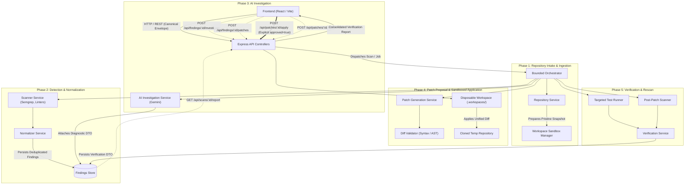

# VULNEX System Architecture & Integration Contract

> **Document Status:** CANONICAL ARCHITECTURE SPECIFICATION
> **Target Version:** VULNEX v1.0.0
> **Last Updated:** 2026-10-31
> **Applies to:** Full System Pipeline, Service Boundaries, Orchestration Engine, and Security Sandbox.

---

## 1. Architectural Overview & System Flow

VULNEX is an AI-assisted software security platform designed to detect code vulnerabilities, conduct root-cause investigation, generate surgical remediation patches, and empirically verify those patches in isolated workspaces before human approval.

### 1.1 End-to-End Orchestration Flow



---

## 2. Bounded Orchestrator vs Multi-Agent Sprawl

### 2.1 The Bounded Orchestrator Design Principle
VULNEX deliberately rejects unconstrained, free-wheeling multi-agent swarms. Having autonomous LLM agents calling arbitrary tools and communicating in unpredictable loops leads to hallucination cascades, non-deterministic state corruption, token exhaustion, and unverifiable security actions.

Instead, VULNEX employs a **Bounded Orchestrator with Deterministic Service Modules**:
- **Bounded State Machine:** Transitions between scan stages, finding states, and patch states are governed by rigid deterministic rules in code, not LLM prompts.
- **LLMs as Specialized Pure Functions:** AI models (such as Gemini 1.5 Pro) are leveraged strictly for high-value reasoning tasks (root-cause analysis, patch synthesis) with strictly defined Zod schema inputs and outputs.
- **Controllers Stay Thin:** Express controllers only parse HTTP input, invoke validation schemas, call the appropriate service or orchestrator dispatch, and wrap results into the canonical envelope. Business logic belongs strictly in the services.

---

## 3. Subsystem Breakdown & Service Ownership

Responsibility is allocated across three primary technical accountability leads. These leads oversee the reliability and implementation of their areas while adhering to canonical contracts:

```
┌────────────────────────────────────────────────────────────────────────┐
│                          TEAM ACCOUNTABILITY                           │
├────────────────────┬─────────────────────────────┬─────────────────────┤
│   AYUSH PRATAP     │           GAURAV            │    ANAND MAURYA     │
│   Orchestration &  │   Repository Intelligence   │     Detection &     │
│   AI Investigation │         & Patching          │     Verification    │
└────────────────────┴─────────────────────────────┴─────────────────────┘
```

### 3.1 Orchestrator & AI Investigation (Accountability: Ayush)
- **Bounded Orchestrator (`backend/src/orchestrator/`):**
  - Manages job queues, coordinates pipeline stages, and enforces scan state machine transitions (`QUEUED` → `SCANNING` → `COMPLETED` / `PARTIAL`).
  - Implements concurrency limits (`MAX_CONCURRENT_SCANS`) and timeout handling (`SCAN_TIMEOUT_SECONDS`).
- **AI Investigation Service (`backend/src/services/ai.service.js`):**
  - Formulates structured prompts containing code context, scanner rules, and CWE metadata.
  - Interacts with upstream LLM providers (Gemini API) using retries and timeouts.
  - Implements local heuristic fallbacks when remote AI keys are not configured.
  - Parses and validates LLM responses through `AIInvestigationOutputSchema` to guarantee schema compliance.

### 3.2 Repository Intelligence & Patching (Accountability: Gaurav)
- **Repository Service (`backend/src/repositories/`):**
  - Validates repository sources (HTTPS Git clone vs ZIP upload).
  - Sanitizes source URLs and prevents internal network access (SSRF protection).
  - Maintains repository metadata and versioning records.
- **Workspace Sandbox Manager:**
  - Creates ephemeral, isolated workspace directories under `.workspaces/<workspaceId>`.
  - Guarantees strict isolation from the primary repository source.
- **Patch Generation & Validation Service (`backend/src/services/patch.service.js`):**
  - Synthesizes targeted Unified Diffs (`diff -u`) resolving diagnosed vulnerabilities.
  - Validates patch syntax and AST integrity before proposing to user.
  - Applies patches exclusively to **disposable workspaces** after receiving explicit approval.

### 3.3 Detection & Verification (Accountability: Anand)
- **Scanner Service (`backend/src/services/scanner.service.js`):**
  - Wraps static analysis engines (Semgrep, ESLint, custom AST heuristics).
  - Executes scanner subprocesses within resource-bounded sandboxes.
  - Collects raw findings, line numbers, CWE tags, and code snippets.
- **Normalizer Service:**
  - Converts disparate scanner outputs into canonical `Finding` entities.
  - Computes deterministic SHA-256 fingerprints to deduplicate findings across runs.
- **Verification Service (`backend/src/services/verification.service.js`):**
  - Executes automated unit tests within the disposable workspace.
  - Triggers post-patch scanner rescan on modified files.
  - Verifies that the targeted vulnerability is completely eradicated and no new security flaws or regressions were introduced.

---

## 4. Pipeline Stages & Inter-Service Data Contract

| Step | Initiator | Target Service | Payload / Data Passed | Async / Sync | Failure Handling |
| :---: | :--- | :--- | :--- | :---: | :--- |
| **1** | Express Controller | Orchestrator | `repositoryId`, `ref`, `scanners` | Async (HTTP 202) | Immediate 400/404 if repository invalid |
| **2** | Orchestrator | Workspace Sandbox | `sourceUrl` / ZIP archive | Async | State becomes `FAILED` (`WORKSPACE_ERROR`) |
| **3** | Orchestrator | Scanner Service | Isolated workspace file path | Async | If one scanner fails, mark scan `PARTIAL`; if all fail, mark `FAILED` |
| **4** | Scanner Service | Normalizer | Raw JSON output from tools | Sync | Discard malformed items; log warning |
| **5** | Normalizer | Persistence | Canonical `Finding[]` entities | Sync | Rollback transaction on DB write error |
| **6** | UI User | AI Service | `findingId`, `additionalContext` | Sync / Poll | Returns safe heuristic fallback or 503 |
| **7** | UI User | Patch Service | `findingId`, `instructions` | Sync / Poll | Returns 422 if diff invalid |
| **8** | UI User | Patch Sandbox | `patchId`, `approved: true` | Sync | **Rejects if `approved !== true`** (403) |
| **9** | Patch Sandbox | Workspace Sandbox | Cloned temp repo path + diff | Sync | Abort on merge conflict; preserve base |
| **10** | Orchestrator | Verification Service| `patchId`, `appliedWorkspaceId` | Async / Sync | Sets verification status `FAILED` / `INCONCLUSIVE` |

---

## 5. Security Invariants & Boundaries

Security cannot be treated as an afterthought in an automated remediation platform. All developers and subagents must enforce the following non-negotiable boundaries:

### 5.1 Disposable Workspace Isolation
- **Rule:** **Never apply patches directly to the original repository or host files.**
- **Implementation:**
  - When `POST /api/patches/:id/apply` is called, the orchestrator provisions a new temporary directory: `.workspaces/ws_disposable_<id>/`.
  - The repository snapshot is cloned or extracted into this disposable directory.
  - The patch diff is applied inside this directory.
  - All test runners and post-patch scanners execute inside this directory.
  - If the patch is rejected or verification fails, the entire `.workspaces/ws_disposable_<id>/` folder is purged.

### 5.2 Mandatory Human-in-the-Loop Approval Gate
- **Rule:** AI-generated code patches must **never** be applied automatically without human review.
- **Implementation:**
  - `POST /api/patches/:id/apply` requires an explicit JSON payload: `{"approved": true}`.
  - Any request where `approved` is omitted, `false`, or null is rejected with `403 Forbidden` (`APPROVAL_REQUIRED`).
  - An immutable `AuditEvent` is persisted recording the approving user ID, patch ID, and timestamp.

### 5.3 Untrusted Repository Content Handling
- **Rule:** All submitted repositories, ZIP files, and project file names must be treated as untrusted input.
- **Implementation:**
  - File extraction routines must validate that no zip slip or relative path traversal sequences (`../`, `~`) exist in archive entries.
  - Filesystem access must be strictly bounded to the allocated workspace directory.
  - No arbitrary client-supplied paths are ever passed directly to system shells.

### 5.4 Separation of Scanner Evidence vs AI Interpretation
- **Rule:** Objective tool findings and subjective AI opinions must remain strictly partitioned.
- **Implementation:**
  - The `Finding` entity preserves the untouched scanner evidence (`evidence.codeSnippet`, `evidence.rawMatch`).
  - AI analysis is encapsulated entirely within the separate `Investigation` entity.
  - The platform never overrides or deletes scanner findings based solely on AI conjecture.

### 5.5 Partial Scan Results vs Complete Failure
- **Rule:** A single scanner crash must not invalidate an entire security scan.
- **Implementation:**
  - If one scanner (e.g., a specific linter) crashes or times out while another (e.g., Semgrep) succeeds, the scan transitions to `PARTIAL` rather than `FAILED`.
  - The UI alerts the user that findings are partial and lists the failing tool under `toolVersions`.

### 5.6 Non-Claim of Universal Security
- **Rule:** Remediating a specific finding does not imply the codebase is bug-free or secure.
- **Implementation:**
  - Reports and UI banners must clearly articulate that verification only proves the targeted rule is no longer triggered and that targeted tests passed.

---

## 6. Implementation Status: Verified Code vs Planned Architecture

To maintain complete architectural honesty across the team, the table below contrasts what currently exists in the codebase versus what is specified in this canonical architecture:

| Component | Verified in Working Codebase (commit `7d24d37`) | Planned Canonical Architecture Specification | Action Required for Alignment |
| :--- | :--- | :--- | :--- |
| **Response Format** | Inconsistent `{ success: false, error: "string" }` without `requestId`. | Standard envelope `{ success, data, requestId }` and structured error `{ code, message }`. | Implement global response formatting middleware in `backend/src/middleware/`. |
| **Routing** | Mixed non-canonical paths (`/analyze`, `/generate-patch`, `/verify-patch`, `/apply-patch`). | Canonical REST paths (`/investigate`, `/patches`, `/patches/:id/apply`, `/patches/:id/verify`). | Refactor route files in `backend/src/routes/` to mirror canonical contracts. |
| **Scanner Service**| Empty file (0 bytes) in `backend/src/services/scanner.service.js`. | Robust wrapper for Semgrep, linters, and AST parsing engines. | Implement `scanner.service.js` with functional list, scan, and normalization methods. |
| **Workspace Sandboxing**| `patch.service.js` writes patches directly to host disk (`fs.writeFileSync(filePath)`). | Patches applied exclusively to disposable workspaces under `.workspaces/`. | Refactor `patch.service.js` to create ephemeral workspace directories and reject host mutation. |
| **Approval Gate** | `apply-patch` route applies patch unconditionally if code provided in body. | Mandatory `approved: true` body check with `403 Forbidden` rejection. | Add approval validation in controller and service layers. |
| **Persistence** | Volatile in-memory `Map` in `repository.routes.js`. | Structured database models and DTO mappings via `repositories/`. | Introduce database storage or robust repository layer adhering to `DATA_MODELS.md`. |
| **Controllers** | Route files contain business logic directly. | Thin controllers dispatching to dedicated service modules. | Move business logic from `routes/` into `controllers/` and `services/`. |
| **Frontend Client**| Minimal React/Vite template calling `GET /api/health`. | Full UI rendering scans, findings list, diff visualizer, and verification reports. | Build dashboard components consuming canonical endpoints and unwrapping envelopes. |
