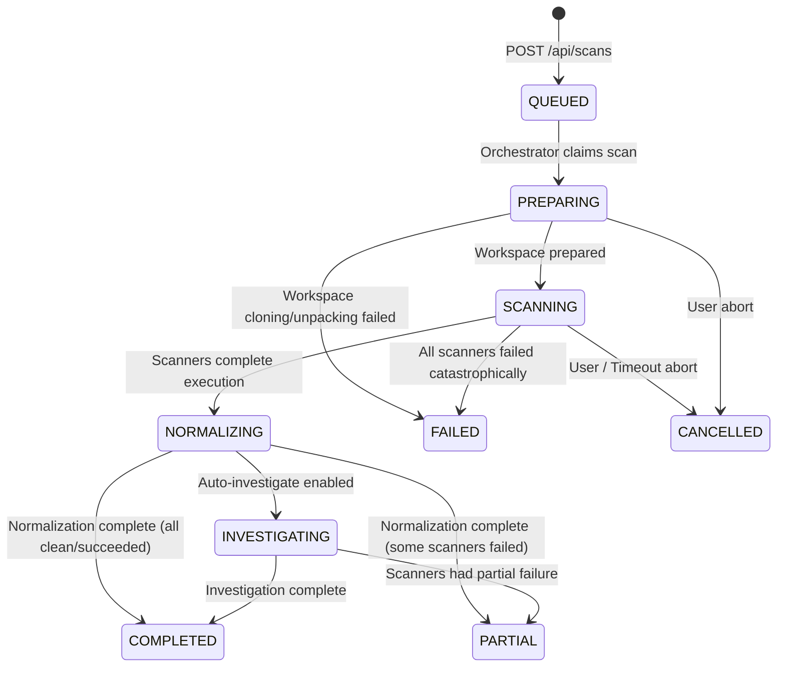
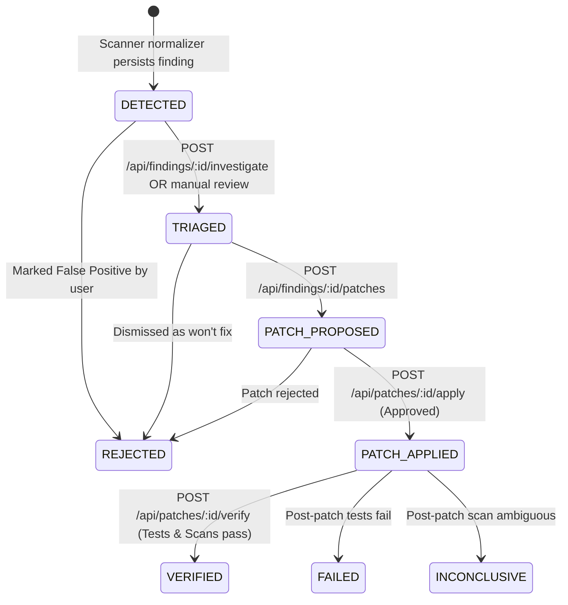
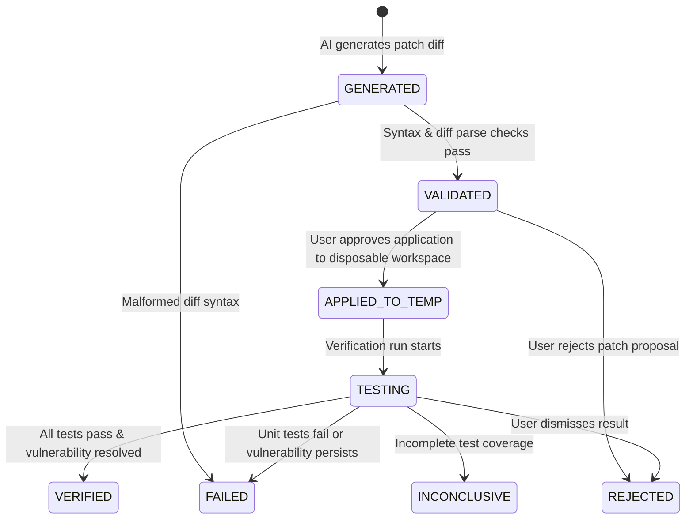

# VULNEX Canonical Data Models & State Machines

> **Document Status:** CANONICAL DATA MODEL SPECIFICATION
> **Target Version:** VULNEX v1.0.0
> **Last Updated:** 2026-10-31
> **Applies to:** Backend Models, DTO Mappings, Zod Schemas, Database Migrations, and Frontend Types.

---

## 1. Overview & Modeling Guidelines

This document specifies the canonical entity definitions, field specifications, data types, nullability, and state machines for VULNEX.

### Core Modeling Rules
1. **Identifier Standard:** All primary keys are immutable strings. Recommended formats: UUIDv4 or ULID with typed prefix (e.g., `repo_...`, `scan_...`, `find_...`, `inv_...`, `patch_...`, `ver_...`, `aud_...`).
2. **Timestamps:** Every timestamp must be stored and serialized as an ISO 8601 UTC string (`YYYY-MM-DDTHH:mm:ss.sssZ`).
3. **Immutability of Audit Records:** `AuditEvent`, `Verification`, and historical findings are append-only.
4. **DTO Mapping Boundary:** Internal database representations must pass through explicit DTO mapping functions before being returned in HTTP responses.
5. **No Schema Bleed:** AI subagents and scanners must serialize data through validated Zod schemas.

---

## 2. Canonical Entity Definitions

---

### 2.1 Repository Entity

Represents a source code project registered for security scanning and remediation.

| Field Name | Data Type | Required | Nullable | Description | Allowed Enums / Constraints |
| :--- | :--- | :---: | :---: | :--- | :--- |
| `id` | String | Yes | No | Unique repository identifier. | e.g. `repo_01JAZZ80001` |
| `sourceType` | String | Yes | No | Intake method of repository. | `"GITHUB"`, `"ZIP_UPLOAD"` |
| `displayName` | String | Yes | No | Human-readable name of repository. | 1 to 100 characters |
| `sanitizedSourceUrl` | String | No | Yes | Public or enterprise Git HTTPS URL (null if ZIP upload). | Valid HTTPS URL |
| `defaultRef` | String | Yes | No | Target branch, tag, or commit reference. | e.g. `"main"`, `"master"` |
| `createdAt` | String | Yes | No | Timestamp of repository registration. | ISO 8601 UTC |

> **Prototype Divergence Note:** The existing prototype in `repository.routes.js` used `name`, `url`, `path`, and `branch`. The canonical contract standardizes on `displayName`, `sanitizedSourceUrl`, and `defaultRef`. Host paths (`path`) must **never** be accepted from or exposed to the frontend.

---

### 2.2 Scan Entity

Represents an individual security scan execution cycle against a repository.

| Field Name | Data Type | Required | Nullable | Description | Allowed Enums / Constraints |
| :--- | :--- | :---: | :---: | :--- | :--- |
| `id` | String | Yes | No | Unique scan identifier. | e.g. `scan_01JAZZ80002` |
| `repositoryId` | String | Yes | No | Foreign reference to associated `Repository`. | Valid `repo_*` |
| `ref` | String | Yes | No | The specific Git reference or snapshot scanned. | e.g. `"main"`, `"commit-sha"` |
| `status` | String | Yes | No | Overall lifecycle state of scan execution. | See Section 3.1 (`Scan State Machine`) |
| `stage` | String | Yes | No | Current sub-stage of processing. | Matches Scan state |
| `toolVersions` | Object | Yes | No | Key-value mapping of scanner tool names to active versions. | e.g. `{"semgrep": "1.70.0"}` |
| `startedAt` | String | No | Yes | Execution start timestamp (null while queued). | ISO 8601 UTC |
| `completedAt` | String | No | Yes | Execution termination timestamp (null while in-flight).| ISO 8601 UTC |
| `errorCode` | String | No | Yes | Machine error code if scan terminated in `FAILED` state. | e.g. `"SCANNER_TIMEOUT"`, null |
| `createdAt` | String | Yes | No | Creation timestamp of the scan record. | ISO 8601 UTC |

---

### 2.3 Finding Entity

Represents an individual security flaw, code defect, or policy violation detected by an automated scanner.

| Field Name | Data Type | Required | Nullable | Description | Allowed Enums / Constraints |
| :--- | :--- | :---: | :---: | :--- | :--- |
| `id` | String | Yes | No | Unique finding identifier. | e.g. `find_01JAZZ80003` |
| `scanId` | String | Yes | No | Foreign reference to originating `Scan`. | Valid `scan_*` |
| `scanner` | String | Yes | No | Tool that identified the finding. | `"semgrep"`, `"eslint"`, `"custom-heuristic"` |
| `ruleId` | String | Yes | No | Scanner-specific rule identifier. | e.g. `"javascript.express.sqli"` |
| `title` | String | Yes | No | Concise summary of the security vulnerability. | 1 to 200 characters |
| `category` | String | Yes | No | Standardized vulnerability category classification. | `"INJECTION"`, `"BROKEN_AUTH"`, `"SENSITIVE_DATA_EXPOSURE"`, `"SECURITY_MISCONFIG"`, `"VULNERABLE_COMPONENTS"`, `"PATH_TRAVERSAL"`, `"OTHER"` |
| `severity` | String | Yes | No | Severity level of vulnerability. | `"CRITICAL"`, `"HIGH"`, `"MEDIUM"`, `"LOW"`, `"INFO"` |
| `confidence` | String | Yes | No | Detection confidence score or tier. | `"HIGH"`, `"MEDIUM"`, `"LOW"` |
| `filePath` | String | Yes | No | Relative file path within repository. | Normalized relative path (no `..`) |
| `startLine` | Integer | Yes | No | 1-based start line number in source file. | >= 1 |
| `endLine` | Integer | Yes | No | 1-based end line number in source file. | >= startLine |
| `message` | String | Yes | No | Descriptive explanation of finding from scanner. | Text |
| `evidence` | Object | Yes | No | Raw snippet, AST context, and scanner metadata. | `{ codeSnippet: string, rawMatch?: object }` |
| `fingerprint` | String | Yes | No | SHA-256 hash derived from rule, path, and normalized code for deduplication across scans. | 64-character hex string |
| `status` | String | Yes | No | Lifecycle remediation status of finding. | See Section 3.2 (`Finding State Machine`) |
| `createdAt` | String | Yes | No | Discovery timestamp. | ISO 8601 UTC |

> **Prototype Divergence Note:** Existing prototype in `ai.service.js` and `verification.service.js` referenced `file` (instead of `filePath`), `cwe` (instead of `category`), `codeSnippet` (now nested inside `evidence.codeSnippet`), and `name` (standardized as `title`).

---

### 2.4 Investigation Entity

Represents an AI-assisted deep diagnostic assessment of a security finding.

| Field Name | Data Type | Required | Nullable | Description | Allowed Enums / Constraints |
| :--- | :--- | :---: | :---: | :--- | :--- |
| `id` | String | Yes | No | Unique investigation identifier. | e.g. `inv_01JAZZ80004` |
| `findingId` | String | Yes | No | Foreign reference to target `Finding`. | Valid `find_*` |
| `model` | String | Yes | No | Name/version of LLM provider utilized. | e.g. `"gemini-1.5-pro"` |
| `promptVersion` | String | Yes | No | Version of structured system prompt used. | e.g. `"v1.2.0"` |
| `assessment` | String | Yes | No | Determination of true positive vs false positive. | Markdown / Text |
| `explanation` | String | Yes | No | Root-cause analysis explaining vulnerable code path. | Markdown / Text |
| `impact` | String | Yes | No | Potential business/security consequence if exploited. | Markdown / Text |
| `recommendation` | String | Yes | No | Actionable guidance on proper defensive refactoring. | Markdown / Text |
| `confidence` | Float | Yes | No | AI confidence in the diagnostic evaluation. | Float between `0.0` and `1.0` |
| `limitations` | Array[String]| Yes | No | Known caveats or blind spots in AI evaluation. | Non-empty array of strings |
| `createdAt` | String | Yes | No | Generation timestamp. | ISO 8601 UTC |

---

### 2.5 Patch Entity

Represents an AI-generated code modification proposal designed to resolve a specific finding.

| Field Name | Data Type | Required | Nullable | Description | Allowed Enums / Constraints |
| :--- | :--- | :---: | :---: | :--- | :--- |
| `id` | String | Yes | No | Unique patch identifier. | e.g. `patch_01JAZZ80005` |
| `findingId` | String | Yes | No | Foreign reference to target `Finding`. | Valid `find_*` |
| `diff` | String | Yes | No | Standard Unified Diff (`diff -u`) format. | Valid unified diff syntax |
| `rationale` | String | Yes | No | Technical explanation of how patch resolves defect. | Text |
| `status` | String | Yes | No | Lifecycle status of patch proposal. | See Section 3.3 (`Patch State Machine`) |
| `changedFiles` | Array[String]| Yes | No | Relative paths of all files touched by diff. | Non-empty array of file paths |
| `appliedWorkspaceId` | String | No | Yes | Identifier of disposable workspace where patch was applied. | `null` until applied |
| `createdAt` | String | Yes | No | Generation timestamp. | ISO 8601 UTC |

---

### 2.6 Verification Entity

Represents the empirical post-patch testing and rescanning results that validate whether a patch effectively remediated a finding without causing regressions.

| Field Name | Data Type | Required | Nullable | Description | Allowed Enums / Constraints |
| :--- | :--- | :---: | :---: | :--- | :--- |
| `id` | String | Yes | No | Unique verification identifier. | e.g. `ver_01JAZZ80006` |
| `patchId` | String | Yes | No | Foreign reference to evaluated `Patch`. | Valid `patch_*` |
| `testResults` | Object | Yes | No | Structured outcome from executing unit/integration tests. | `{ syntaxValid: boolean, testsExecuted: number, passed: number, failed: number, durationMs: number }` |
| `scannerResults` | Object | Yes | No | Outcome of post-patch security scan. | `{ originalFindingResolved: boolean, ruleId: string, newFindingsCount: number, newFindings: array }` |
| `beforeAfterComparison`| Object | Yes | No | AST/syntax diff analysis verifying targeted change. | `{ astDifferenceVerified: boolean, regressionDetected: boolean }` |
| `status` | String | Yes | No | Overall verification outcome. | `"PASSED"`, `"FAILED"`, `"INCONCLUSIVE"` |
| `logsReference` | String | No | Yes | Relative path or URI to archived test execution logs. | e.g. `"logs/verification_01.log"`, null |
| `createdAt` | String | Yes | No | Verification completion timestamp. | ISO 8601 UTC |

---

### 2.7 AuditEvent Entity

Represents an immutable security event log tracking all state mutations and human actions.

| Field Name | Data Type | Required | Nullable | Description | Allowed Enums / Constraints |
| :--- | :--- | :---: | :---: | :--- | :--- |
| `id` | String | Yes | No | Unique audit record identifier. | e.g. `aud_01JAZZ80007` |
| `actor` | String | Yes | No | Entity responsible for initiating action. | e.g. `"user_alice"`, `"system_orchestrator"`, `"agent_investigator"` |
| `action` | String | Yes | No | Action type performed. | `"REPOSITORY_REGISTER"`, `"SCAN_TRIGGER"`, `"INVESTIGATION_REQUEST"`, `"PATCH_GENERATE"`, `"PATCH_APPLY_APPROVED"`, `"PATCH_VERIFY"`, `"PATCH_REJECT"` |
| `entityId` | String | Yes | No | ID of affected entity (`repo_*`, `scan_*`, etc.). | Valid entity ID |
| `timestamp` | String | Yes | No | Exact time event occurred. | ISO 8601 UTC |
| `outcome` | String | Yes | No | Result of the audited action. | `"SUCCESS"`, `"FAILURE"`, `"DENIED"` |
| `requestId` | String | Yes | No | Correlated HTTP or job request ID. | e.g. `req_01HZX87K79...` |

---

## 3. Canonical State Machines

State transitions are strictly owned by specific backend services. **The frontend client is never permitted to independently invent or directly mutate state fields.**

---

### 3.1 Scan State Machine



#### State Definitions
- **`QUEUED`**: Scan request validated and recorded; waiting for worker or orchestrator pickup.
- **`PREPARING`**: Repository snapshot being checked out or unzipped into sandboxed execution workspace.
- **`SCANNING`**: Scanner subprocesses (e.g., Semgrep, linters) actively analyzing codebase.
- **`NORMALIZING`**: Raw scanner outputs being parsed into canonical `Finding` entities and deduplicated.
- **`INVESTIGATING`**: Optional pipeline phase where critical findings receive initial AI triage.
- **`COMPLETED`**: Terminal success state; all configured scanners ran successfully and findings were persisted.
- **`PARTIAL`**: Terminal warning state; at least one configured scanner failed or timed out, but surviving scanners yielded usable findings.
- **`FAILED`**: Terminal error state; scan aborted without producing valid findings.
- **`CANCELLED`**: Terminal abort state; scan terminated via user request or execution timeout.

#### Transition Governance
- **Owning Service:** Orchestrator (`orchestrator/`).
- **Permitted Transitions:**
  - `QUEUED` → `PREPARING`, `CANCELLED`
  - `PREPARING` → `SCANNING`, `FAILED`, `CANCELLED`
  - `SCANNING` → `NORMALIZING`, `FAILED`, `CANCELLED`
  - `NORMALIZING` → `INVESTIGATING`, `COMPLETED`, `PARTIAL`, `FAILED`
  - `INVESTIGATING` → `COMPLETED`, `PARTIAL`, `FAILED`
- **Invalid Transitions:**
  - Any transition from terminal states (`COMPLETED`, `PARTIAL`, `FAILED`, `CANCELLED`).
  - Skipping stages (e.g., `QUEUED` → `NORMALIZING`).

---

### 3.2 Finding State Machine



#### State Definitions
- **`DETECTED`**: Raw vulnerability found and normalized; no deep triage or AI investigation performed yet.
- **`TRIAGED`**: Root-cause analysis completed; assessed as true positive or confirmed priority.
- **`PATCH_PROPOSED`**: Reviewable diff generated and attached to finding.
- **`PATCH_APPLIED`**: Patch applied to a disposable workspace with explicit user approval.
- **`VERIFIED`**: Post-patch automated test suite and rescan proved the vulnerability is neutralized with zero regressions.
- **`REJECTED`**: Marked as a false positive, acceptable risk, or declined by human reviewer.
- **`FAILED`**: Proposed patch broke test suite, failed syntax validation, or failed to neutralize the vulnerability.
- **`INCONCLUSIVE`**: Verification tests or rescans returned contradictory or indeterminate results.

#### Transition Governance
- **Owning Services:**
  - `DETECTED`: Detection Normalizer.
  - `TRIAGED`: AI Investigation Service (`ai.service.js`).
  - `PATCH_PROPOSED`: Patch Service (`patch.service.js`).
  - `PATCH_APPLIED`: Patch Sandbox Manager.
  - `VERIFIED` / `FAILED` / `INCONCLUSIVE`: Verification Service (`verification.service.js`).
- **Terminal States:** `VERIFIED`, `REJECTED`, `FAILED`, `INCONCLUSIVE`.

---

### 3.3 Patch State Machine



#### State Definitions
- **`GENERATED`**: Diff produced by AI or patch template; not yet checked for basic syntax validity.
- **`VALIDATED`**: Unified diff parses cleanly and applies without hunk conflicts against the base file.
- **`APPLIED_TO_TEMP`**: Patch applied to isolated disposable workspace under `.workspaces/`. Original code remains pristine.
- **`TESTING`**: Targeted automated unit tests and scanner rescans actively executing in the disposable workspace.
- **`VERIFIED`**: All test suites passed, post-patch scan found no instance of original finding, and no new findings introduced.
- **`FAILED`**: Patch failed to apply, broke syntax, failed existing tests, or failed to remediate the vulnerability.
- **`REJECTED`**: Patch explicitly discarded by human reviewer.
- **`INCONCLUSIVE`**: Verification could not definitively confirm resolution (e.g., missing test suite).

#### Transition Governance
- **Owning Services:** Patch Service & Verification Service.
- **Safety Rule:** No patch may transition to `APPLIED_TO_TEMP` without `approved: true` in the request body.

---

## 4. Zod Schema Validation Strategy

To enforce contract integrity in Node.js (CommonJS), all API request bodies and AI-generated outputs must validate against shared Zod schemas before entering the business layer.

### 4.1 Example Canonical Zod Schemas

```javascript
const { z } = require('zod');

// Repository Registration Schema
const RegisterRepositorySchema = z.object({
  sourceType: z.enum(['GITHUB', 'ZIP_UPLOAD']),
  displayName: z.string().min(1).max(100),
  sourceUrl: z.string().url().startsWith('https://').optional(),
  defaultRef: z.string().default('main')
}).refine(data => {
  if (data.sourceType === 'GITHUB') return !!data.sourceUrl;
  return true;
}, {
  message: "sourceUrl is required when sourceType is GITHUB",
  path: ["sourceUrl"]
});

// Scan Initiation Schema
const CreateScanSchema = z.object({
  repositoryId: z.string().startsWith('repo_'),
  ref: z.string().optional(),
  scanners: z.array(z.string()).optional()
});

// Patch Approval Schema
const ApplyPatchSchema = z.object({
  approved: z.literal(true, {
    errorMap: () => ({ message: "Explicit human approval (approved: true) is required to apply patches." })
  }),
  approverComments: z.string().optional()
});

// Structured AI Investigation Output Schema
const AIInvestigationOutputSchema = z.object({
  assessment: z.string().min(1),
  explanation: z.string().min(1),
  impact: z.string().min(1),
  recommendation: z.string().min(1),
  confidence: z.number().min(0.0).max(1.0),
  limitations: z.array(z.string()).default([])
});

module.exports = {
  RegisterRepositorySchema,
  CreateScanSchema,
  ApplyPatchSchema,
  AIInvestigationOutputSchema
};
```
